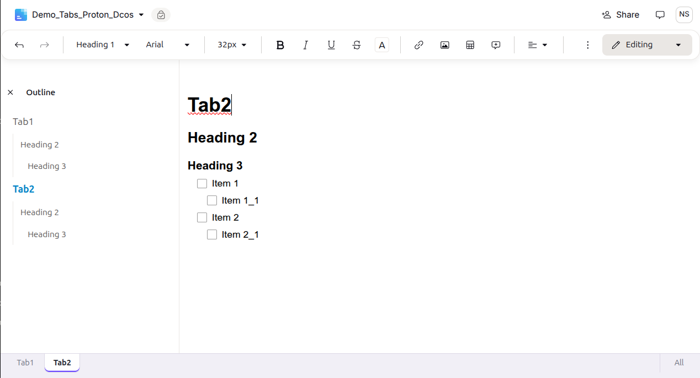
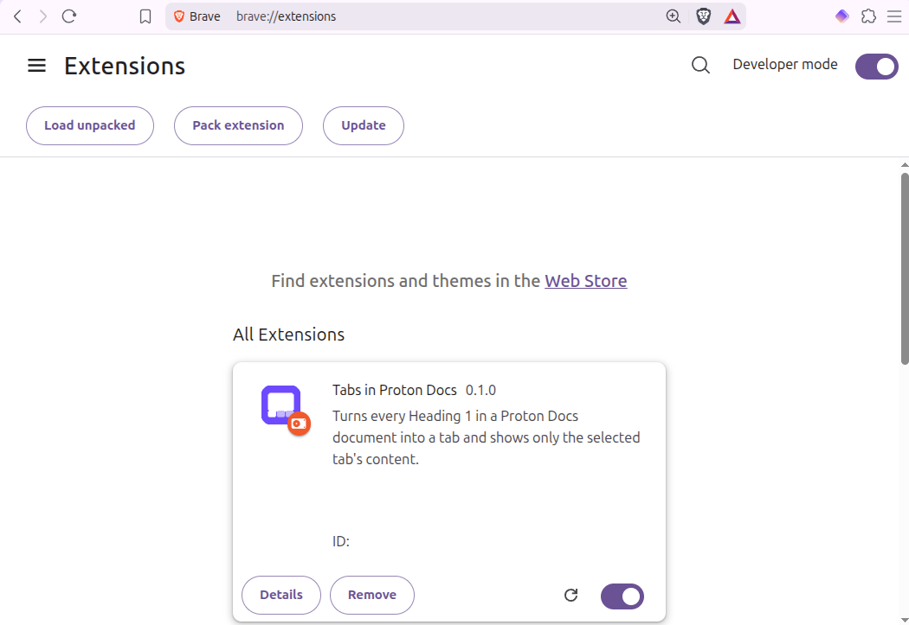

# Tabs in Proton Docs
**—Add multiple tabs in Proton Docs**

A small browser extension that adds tabs to [Proton Docs](https://proton.me/drive/docs) documents. Every **Heading 1** in your document becomes a tab, and only the selected tab's content is shown. Headings 2 to 6 stay free to use inside each tab. The Outline sidebar on the left works as usual within the current tab but does not switch between tabs; use the tab bar at the bottom for that.

> [!IMPORTANT]
>  with Proton Docs and the Proton Docs Editor version 0.2.205.0 in the Brave browser. 
> See the current [Proton Docs version](https://docs.proton.me/assets/version.json) and [Proton Docs Editor version](https://docs-editor.proton.me/assets/version.json).

## Features

- **Heading 1 = new tab**: type `#` followed by a space at the start of a line (or pick *Heading 1* from the toolbar) to create a new tab. The tab label is the heading text.
- **Tab bar at the bottom**: click a tab to show only its content. Click **All** to show the whole document again.
- **Intro tab**: any content above the first Heading 1 gets its own *Intro* tab.
- **Outline pane works as usual**: the outline pane on the left will navigate for Headings 2 to 6 as usual.
- **Safe select-all**: Ctrl+A selects only the visible tab, so you can not accidentally delete other tabs' contents.

## Installation

### Firefox

Install the extension from [Mozilla Add-ons](https://addons.mozilla.org/en-US/firefox/addon/tabs-in-proton-docs/). Updates will be installed automatically.

### Brave and Chromium browsers

> [!CAUTION]
> STOP USING GOOGLE CHROME! 
> It offers almost zero benefit to most users over Brave or Firefox; that is, unless you enjoy being Google's guinea pig. Switching takes less than 15 minutes for most people.

1. [Download the extension](https://github.com/Niloy333/Tabs-in-Proton-Docs/raw/refs/heads/base/tabs-in-proton-docs-v0.1.zip) (ZIP file) and unzip it.
2. Keep the folder in a permanent location (e.g., `Documents`), since the browser loads the extension from there.
3. Open the browser's extensions page: `brave://extensions` in Brave or `chrome://extensions` in other Chromium browsers.
4. Turn on **Developer mode** (top right).
5. Click **Load unpacked** and select the folder that contains `manifest.json`.
6. Reload any Proton Docs pages you already have open.

The extension will stay installed and active across browser and system restarts. To update it (manually), replace the folder's contents with the newer version and click the reload icon on the extension's card.

## Tips

- Moving content between tabs: cut it (Ctrl+X), switch tabs, and paste (Ctrl+V). Alternatively, switch to **All**, move it, and switch back.
- To keep completed tasks out of the way, add a `# Done` heading at the end of your document and move finished items there.

## Good to know

- **Your document is never modified.** Tabs are just a visual layer. The extension hides other tabs' content on your screen and saves nothing to the document. Collaborators, the mobile apps, and exports will always see the full document.
- **The selected tab is not remembered.** After reloading the page, the first tab will be shown.
- **Proton updates may break it.** The extension depends on the current structure of the Proton Docs editor. If Proton changes it, the tab bar may stop appearing, but your document stays untouched.
- The extension runs entirely in your browser, makes no network requests, collects no data, and needs no special permissions beyond running on `docs.proton.me` and `docs-editor.proton.me`.

## Disclaimer

This is an independent project for personal use and not affiliated with or endorsed by [Proton AG](https://en.wikipedia.org/wiki/Proton_AG). LLMs were used to modify and customize it. Feel free to use and modify at your own risk.

